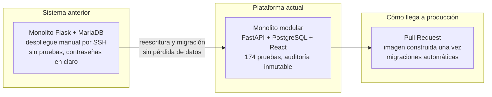

# Kintsugi

**Documentación de diseño, construcción y evolución de una plataforma de gestión de operaciones de servicio técnico de campo.**

La plataforma se desarrolló a medida para una empresa de servicios técnicos y hoy es su herramienta de trabajo diaria. Este repositorio cuenta qué hace, cómo está construida, cómo se migró desde el sistema anterior sin perder un solo dato, qué problemas de seguridad se encontraron por el camino y hacia dónde puede crecer.

[Ver la demo](https://iveliank.github.io/Kintsugi/demo/) · [Funcionalidades](docs/00-producto.md) · [Arquitectura](docs/03-arquitectura.md) · [Hoja de ruta](docs/09-hoja-de-ruta.md)

---

## Qué es la aplicación

Una empresa de servicios técnicos vive de mandar a la persona adecuada al sitio adecuado, en el momento adecuado, y de poder demostrar después qué se hizo. Esta plataforma cubre ese ciclo completo:

1. **Planificar.** La oficina crea órdenes de trabajo para los clientes, a mano, por lotes o generadas solas a partir de servicios que se repiten, y las asigna a técnicos en un calendario que ya tiene en cuenta quién está de vacaciones.
2. **Ejecutar.** El técnico ve sus órdenes, registra entrada, salida, gastos y desplazamiento, adjunta fotos o documentos y recoge la firma del cliente en el momento o por un enlace que el cliente abre en su propio móvil.
3. **Cerrar.** Supervisión revisa, la orden se cierra y queda un parte en PDF firmado, listo para enviar o facturar.
4. **Gestionar a las personas.** Fichas de empleados, tarifas, vacaciones con su cálculo de días, y el reparto mensual de nóminas: se sube un único PDF con toda la plantilla y cada persona recibe solo la suya.
5. **Controlar.** Roles y permisos editables, alcance por equipo, auditoría inmutable de cada acción y despliegues trazables.

Quién la usa:

| Perfil | Qué hace en ella |
|---|---|
| Oficina y coordinación | Planifica, crea y asigna órdenes, gestiona la cartera de clientes |
| Supervisión | Ve y revisa el trabajo de su equipo, cierra órdenes |
| Personal técnico | Ve sus órdenes, las resuelve, adjunta y recoge firmas |
| Administración y RR. HH. | Personas, vacaciones, nóminas, permisos y auditoría |
| Cliente final | Firma el parte desde un enlace, sin cuenta |

> **Sobre los datos.** Este repositorio no menciona el nombre de la empresa, del producto, de clientes, dominios, direcciones ni personas. Las cifras sensibles están redondeadas o expresadas en relativo. No hay capturas de la aplicación real: todo lo visual son diagramas y una demo construida desde cero con datos inventados y un diseño distinto.
>
> **Sobre el nombre.** El kintsugi es la técnica japonesa de reparar cerámica rota con oro, dejando las grietas a la vista. La documentación sigue la misma idea: los errores no se esconden, se cuentan, porque son lo que más enseña.

## En una imagen



## Estado

| | |
|---|---|
| Situación | En producción, uso diario por toda la empresa |
| Sistema anterior | Migrado y retirado |
| Módulos de negocio | 13 |
| Endpoints de API | Más de 100, versionados en `/api/v1` |
| Pruebas automáticas | 174 en el backend, más las del frontend, bloquean el despliegue |
| Migraciones de esquema | 27, aplicadas solas al arrancar |
| Entornos | Pruebas, preproducción y producción |

## Cómo leer esta documentación

| # | Documento | De qué va |
|---|---|---|
| 0 | [El producto](docs/00-producto.md) | Todas las funcionalidades, por áreas y por perfil |
| 1 | [Punto de partida](docs/01-punto-de-partida.md) | Cómo era el sistema anterior y por qué no bastaba con parchearlo |
| 2 | [Línea del tiempo](docs/02-linea-del-tiempo.md) | Qué pasó y cuándo |
| 3 | [Arquitectura](docs/03-arquitectura.md) | Cómo está montada y por qué así |
| 4 | [La migración](docs/04-migracion.md) | El paso de un sistema a otro sin perder datos |
| 5 | [Seguridad](docs/05-seguridad.md) | Vulnerabilidades encontradas, cómo se descubrieron y qué se hizo |
| 6 | [Tropiezos](docs/06-tropiezos.md) | Fallos reales en formato postmortem sin culpables |
| 7 | [Impacto](docs/07-impacto.md) | Qué ha cambiado para la empresa |
| 8 | [Lo aprendido](docs/08-lecciones.md) | Lo que haría igual y lo que no |
| 9 | [Hoja de ruta](docs/09-hoja-de-ruta.md) | Las funcionalidades que vienen |
| 10 | [Escalar y blindar](docs/10-escalar-y-blindar.md) | Cómo llevarla de una empresa a miles, y cómo protegerla a esa escala |
| - | [Registro de decisiones](docs/decisiones/README.md) | Las decisiones de arquitectura, una por fichero |

Si solo tienes cinco minutos: lee este README, [el producto](docs/00-producto.md) y [los tropiezos](docs/06-tropiezos.md).

## La demo

**[Abrir la demo](https://iveliank.github.io/Kintsugi/demo/)**. No se parece al producto real a propósito, pero reproduce su lógica con datos inventados. Cambia de perfil arriba a la derecha para ver cómo cambian datos y permisos.

| Pestaña | Qué enseña |
|---|---|
| Panel | Indicadores, órdenes por día, carga por persona y actividad reciente, todo filtrado por tu alcance |
| Órdenes | Listado con filtros, alta individual o por rango de fechas, resolución con firma dibujada y parte imprimible |
| Calendario | Semana a semana, con ausencias dentro del calendario y avisos de conflicto |
| Nóminas | Un PDF de toda la plantilla troceado y repartido por persona, con cola de revisión y panel personal |
| Roles | La matriz de permisos y alcances de cada perfil |
| Auditoría | La cadena de hashes SHA-256: manipula una fila y comprueba cómo se detecta |
| Despliegue | Una imagen construida una vez y promovida entre entornos, con migraciones al arrancar |

Atajos: <kbd>N</kbd> nueva orden, <kbd>/</kbd> buscar. Tema claro y oscuro.

### Desplegarla

La demo se puede publicar de varias formas, todas explicadas en la [guía de despliegue](deploy/README.md):

```bash
docker run -d -p 8080:8080 --read-only --tmpfs /tmp --cap-drop ALL ghcr.io/iveliank/kintsugi-demo:latest
```

El paquete incluye `Dockerfile` con nginx sin privilegios y CSP estricta, `docker-compose.yml` endurecido, un workflow que publica la imagen en GitHub Packages para amd64 y arm64, y un zip en cada [versión publicada](https://github.com/IvelianK/Kintsugi/releases) para subirla a cualquier hosting.

## Stack

| Capa | Tecnología |
|---|---|
| Backend | Python, FastAPI, SQLAlchemy 2, Alembic, APScheduler |
| Datos | PostgreSQL, Valkey (sesiones y flujos de eventos), SeaweedFS (ficheros) |
| Frontend | React, Vite, TypeScript, CSS propio sin librería de componentes |
| Seguridad | Argon2id, RBAC + ABAC, CSP estricta, auditoría con hash encadenado |
| Entrega | Docker Compose, Forgejo autoalojado con CI propio, nginx |
| Observabilidad | Prometheus, Grafana |

## Cinco ideas que resumen el proyecto

1. Reescribir fue más barato que seguir parcheando, pero solo porque la migración de datos se podía ensayar tantas veces como hiciera falta.
2. La decisión más importante no fue técnica: saber que el producto se instalaría en el servidor de cada cliente y nunca en uno propio. Eso tumbó media arquitectura.
3. Lo que más tiempo ha devuelto es que desplegar dejara de ser una tarea: ahora es aceptar un Pull Request.
4. Los fallos de seguridad más serios no estaban en la parte "de seguridad", sino en rutas normales que comprobaban el permiso pero no a quién pertenecía el dato.
5. Un sistema más escalable no es mejor si hace menos cosas que el anterior.

## Autor

Diseñado, construido y mantenido por [Ivelian](https://github.com/IvelianK).

## Licencia

Documentación bajo [CC BY 4.0](https://creativecommons.org/licenses/by/4.0/deed.es). Código de la demo y del despliegue bajo MIT. Detalle en [LICENSE](LICENSE).
