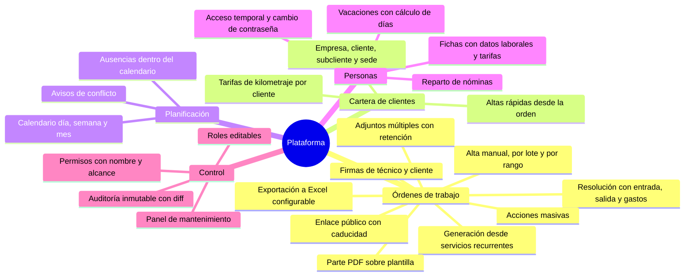
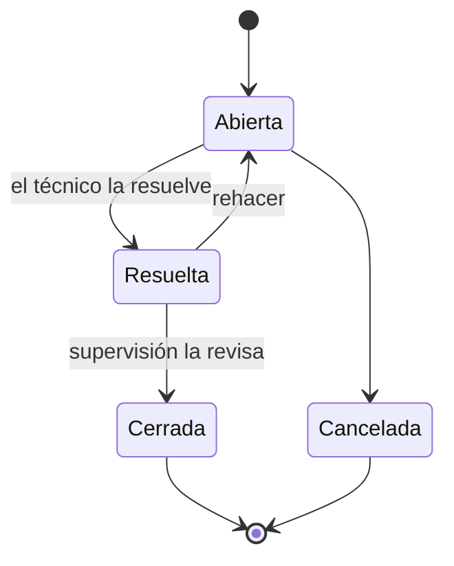
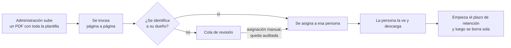
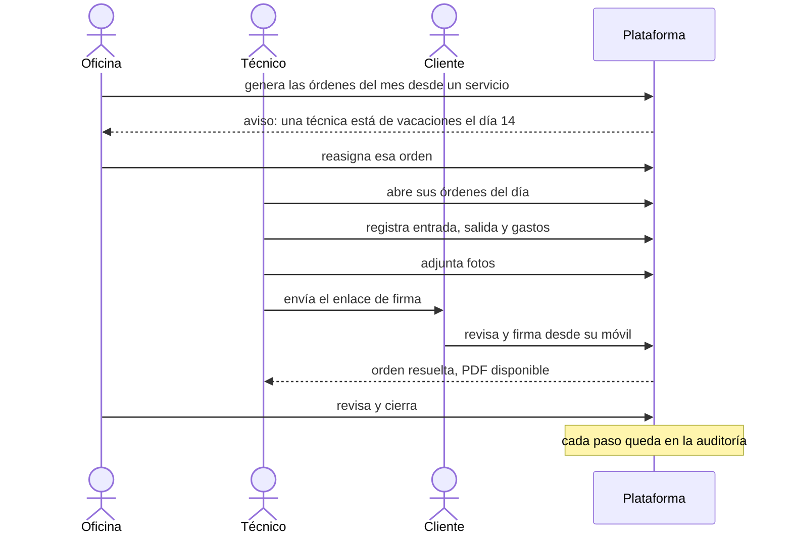

# 0. El producto

Qué hace la plataforma, área por área. Todo lo que aparece en este capítulo está construido y en producción. Lo que está planificado vive aparte, en la [hoja de ruta](09-hoja-de-ruta.md).

## Mapa de funcionalidades

## Órdenes de trabajo

Es el corazón del sistema. Una orden representa una intervención: qué cliente, qué sede, qué técnico, cuándo y qué se hizo.

**Crear**
- **Manual**, con un selector jerárquico de cliente (empresa, cliente, subcliente, sede) con buscador en cada nivel.
- **Para varios técnicos a la vez**: se crea una orden por persona, agrupadas para poder editarlas juntas después.
- **Por lote**, con una parte común (cliente, descripción, tarifa) y lo distinto en cada orden (fecha, hora, técnico).
- **Por rango de fechas**, una orden por día laborable.
- **Desde un servicio recurrente**: el servicio define la periodicidad y la plataforma calcula las fechas y genera todas las órdenes de una vez.
- **Duplicando** una orden existente, sin arrastrar su resolución, firmas ni adjuntos.
- **Altas rápidas**: si el cliente, la sede o el técnico no existen todavía, se crean desde el propio formulario sin perder lo escrito.

**Ejecutar y resolver**
- Hora de entrada y de salida, descripción de la resolución, gastos, desplazamiento y kilometraje.
- La tarifa se resuelve sola a partir de la ficha del técnico (día, noche, jornada, especial o personalizada) y el precio por kilómetro puede venir del técnico o del cliente.
- **Firma del técnico y del cliente** dibujadas en pantalla, con el nombre de quien firma.
- **Enlace público** para que el cliente resuelva y firme desde su propio dispositivo, sin cuenta. Caduca, no muestra importes ni datos internos y deja de aceptar cambios cuando la orden se cierra.
- **Parte en PDF** generado sobre la plantilla corporativa, en versión para el cliente o completa, con las firmas incrustadas.

**Ciclo de vida**

**Adjuntos**
- Hasta veinte ficheros de golpe, en la creación o después, con un máximo por orden.
- Quién puede borrar depende de quién eres: el técnico borra lo suyo, supervisión lo de su equipo salvo lo subido por administración, y quien edita órdenes, todo.
- Los adjuntos caducan y se purgan solos cada noche. Los que se marcan como "nunca borrar" quedan protegidos.

**Trabajar con muchas a la vez**
- Listado con filtros por estado, técnico, cliente y fechas, paginado y con los filtros recordados al volver.
- Acciones masivas: cerrar, cancelar o borrar varias órdenes, comprobando permiso y alcance en cada una.
- Exportación a Excel eligiendo columnas y rango de fechas en un calendario. Las celdas se protegen contra la inyección de fórmulas.

## Cartera de clientes

- Jerarquía de cuatro niveles: **empresa, cliente, subcliente y sede**, con ficha propia en cada nivel y sus datos de contacto.
- Vista global de todos los clientes y vista anidada por empresa.
- Tarifa de kilometraje propia por cliente cuando difiere de la del técnico.
- Borrar un nivel no destruye el historial: las órdenes conservan una copia del nombre aunque el cliente desaparezca.

## Servicios recurrentes

- Plantillas de trabajo que se repiten (por ejemplo, una revisión mensual en una sede durante un año).
- Cálculo de fechas con vista previa antes de generar.
- Generación de todas las órdenes del servicio en una sola acción.

## Planificación y calendario

- Vistas de día, semana y mes, con filtros por técnico.
- **Las ausencias aparecen dentro del propio calendario de trabajo**, al final de cada día y con un estilo por estado (en revisión, aprobadas, disfrutadas).
- **Avisos de conflicto**: si alguien tiene una orden un día que está de vacaciones, administración recibe un aviso que se puede resolver desde el propio aviso. El cálculo lo hace un consumidor de eventos en segundo plano.
- El calendario recuerda vista, fecha y filtros al volver de una orden.

## Personas

**Fichas**
- Datos personales y laborales, tipo de contrato, fechas, tarifas por tipo de jornada y precio por kilómetro.
- Lo sensible solo lo ve quien gestiona personas y la propia persona. El resto ve nombre, estado y rol.

**Accesos**
- Contraseña generada de forma segura al dar de alta, mostrada una única vez.
- Cambio obligatorio de contraseña en el primer acceso.
- **Acceso temporal de 24 horas** con un código, para dar entrada puntual sin crear credenciales permanentes.
- Activar y desactivar cuentas sin borrarlas.
- Sesiones que caducan a las cinco horas y devuelven al login.

**Vacaciones**
- Elegibilidad según tipo de contrato y antigüedad.
- Cálculo de días generados, disfrutados y reservables, persona a persona y en agregado para varias personas.
- Estados (en revisión, aprobadas, disfrutadas) con paso automático a disfrutadas cuando pasa la fecha.
- Vista de calendario y de tabla, filtro por varias personas y exportación a Excel.

**Nóminas**

El flujo que más trabajo manual ha eliminado:

- El PDF original con las nóminas de todo el mundo **no se guarda nunca**. Solo se guardan las páginas ya separadas.
- Cada página se casa con su dueño por su documento de identidad. Lo que no se identifica con certeza no se descarta: espera en una cola de revisión.
- Una nómina enviada a la persona equivocada se puede reasignar sin borrarla, dejando constancia de quién lo hizo.
- El panel de administración lista **a toda la plantilla**, tenga nómina ese mes o no, para que los huecos se vean.
- Estado de pago por nómina y navegación mes a mes.
- Cada trabajador tiene su propio panel con sus nóminas y nada más.

## Control y administración

**Roles y permisos**
- Roles editables desde la interfaz, agrupados por áreas (órdenes, cartera, servicios, personas, administración).
- Diecinueve permisos con nombre, del tipo `tickets:cerrar` o `nominas:gestionar`.
- Permisos sueltos por persona, además de los de su rol.
- **Alcance por tipo de rol**: técnico (lo suyo), supervisor (su equipo), administración (todo).
- La API aplica todo esto, no solo la pantalla. Las páginas sin permiso muestran un 403 propio en lugar de cargar y fallar.

**Auditoría**
- Cada acción de negocio queda registrada con quién, cuándo, desde qué IP y, en las ediciones, el antes y el después de cada campo.
- La tabla solo admite inserciones y cada fila está encadenada a la anterior por hash. Ver [ADR 0008](decisiones/0008-auditoria-encadenada.md).
- Historial legible en cada orden, con nombres en lugar de identificadores.

**Mantenimiento**
- Panel de gestión con tareas de administración, como purgar adjuntos caducados bajo demanda.
- Tareas programadas dentro de la propia aplicación: limpieza nocturna de adjuntos y paso de vacaciones a disfrutadas.
- Páginas de error propias (403, 404, 500) y aviso de "hay una versión nueva, recarga" tras un despliegue.

**Experiencia**
- Panel de inicio con indicadores, próximas órdenes y resumen de la organización.
- Tema claro y oscuro.
- Diseño propio, sin librería de componentes, pensado para pantallas de oficina y para móvil.

## Un día normal, de principio a fin

---

Siguiente: [Punto de partida](01-punto-de-partida.md)
