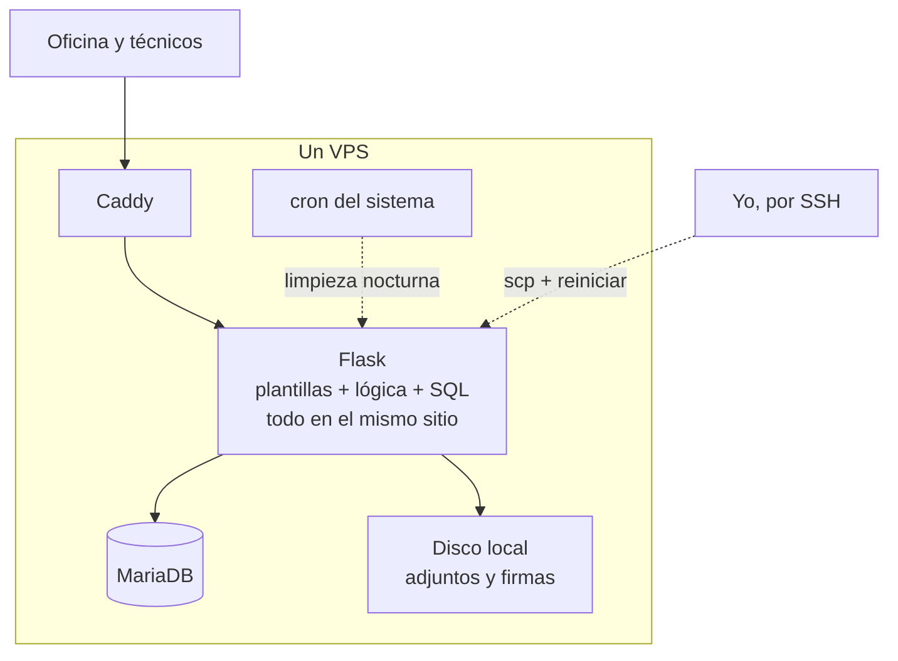

# 1. Punto de partida

## Lo que había

El sistema anterior no nació como un producto. Empezó como una herramienta pequeña para registrar partes de trabajo y fue creciendo a base de peticiones: primero los clientes, luego el calendario, luego las vacaciones, luego los enlaces de firma. Cada pieza resolvía un problema real del día, y cada una se añadió donde había hueco.

Técnicamente era un monolito en Flask con plantillas renderizadas en servidor, Bootstrap y una base de datos MariaDB. Vivía en un VPS junto a su entorno de pruebas. Llevaba tiempo en producción y la usaban a diario oficina y técnicos.

No era mala. Tenía un sistema de diseño propio bastante cuidado, modo claro y oscuro, generaba los partes en PDF sobre una plantilla con coordenadas medidas a mano, y la gente estaba acostumbrada a ella. Eso es importante: cualquier sustituto tenía que hacer, como mínimo, todo lo que hacía ella.

## Lo que dolía

Lo apunto tal y como lo veía entonces, sin ordenar por importancia:

- **Contraseñas en claro.** Se había decidido así en su día "por comodidad" (para poder decirle a alguien su contraseña si la olvidaba) y la decisión se había revertido y vuelto a poner dos veces. Era lo primero que había que quitar.
- **Desplegar daba miedo.** Copiar ficheros por `scp`, reiniciar, cruzar los dedos. Si el cambio tocaba la base de datos, había que acordarse de hacerlo a mano en el orden correcto.
- **Cero pruebas automáticas.** Cada cambio se probaba haciendo clic.
- **Permisos por rol literal.** El código preguntaba `si rol == "administrador"`. Dar a una persona concreta un permiso concreto significaba tocar código.
- **Lógica cruzada a mano.** Un ejemplo: cuando cambiaba una orden de trabajo o unas vacaciones, había que recalcular si algún técnico tenía trabajo asignado un día que estaba fuera. Esa función se llamaba explícitamente desde varios sitios. Si alguien añadía un sitio nuevo y no se acordaba, el aviso dejaba de saltar.
- **Ficheros en el disco del servidor.** Sin separación, sin forma sencilla de moverlos.
- **Una tarea programada fuera de la aplicación** (un `cron` del sistema) que si se perdía al mover el servidor, nadie se enteraba.

## Parchear o reescribir

Esta fue la primera decisión de verdad y está en su propio fichero: [ADR 0001](decisiones/0001-reescribir-en-vez-de-parchear.md).

La versión corta: parchear el sistema antiguo resolvía los problemas de uno en uno, pero ninguno de ellos de raíz. Quitar las contraseñas en claro, por ejemplo, era fácil. Tener pruebas, permisos finos y despliegues seguros sobre un código donde plantillas, lógica y SQL estaban mezclados ya no lo era tanto.

Lo que inclinó la balanza fue darme cuenta de que la migración de datos se podía escribir como un script repetible y ensayarlo contra una copia tantas veces como quisiera, sin tocar producción. Eso convertía la parte más peligrosa de una reescritura (el día del cambio) en algo aburrido.

## La pregunta que lo cambió todo

Antes de escribir una línea dediqué tiempo a la arquitectura. Diseñé algo multiinquilino: una única instalación para varias empresas, aislamiento por filas en la base de datos, todo muy correcto.

Luego pregunté lo obvio, que debería haber preguntado primero: ¿esto se va a alojar en un servidor nuestro o en el de cada cliente?

La respuesta fue "en el de cada cliente, nunca en uno nuestro". Con eso, el aislamiento entre empresas pasa a ser físico (cada una tiene su servidor), y toda la maquinaria multiinquilino sobra. La quité. Ver [ADR 0002](decisiones/0002-una-instalacion-por-empresa.md).

Lo dejo aquí porque es la lección que más me ha servido fuera de este proyecto: **la pregunta de negocio va antes que el diagrama.**

---

Anterior: [El producto](00-producto.md) · Siguiente: [Línea del tiempo](02-linea-del-tiempo.md)
