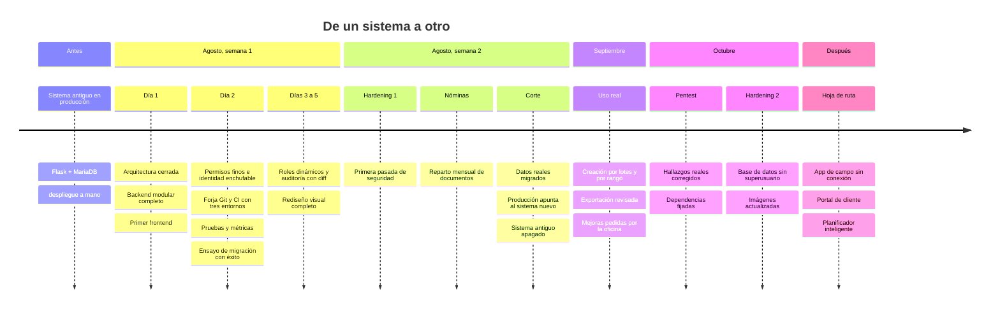
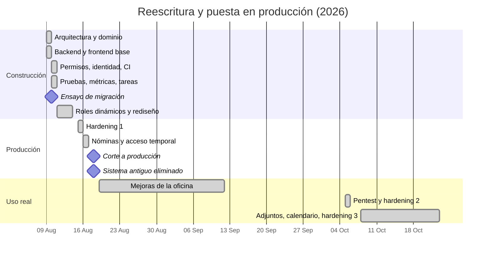
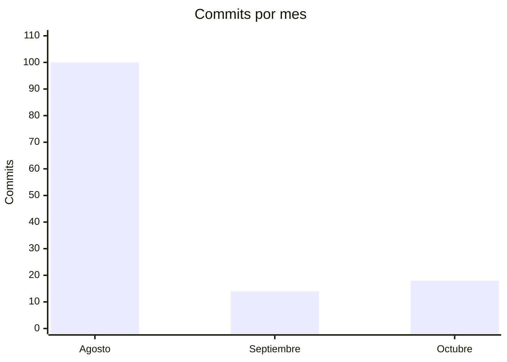
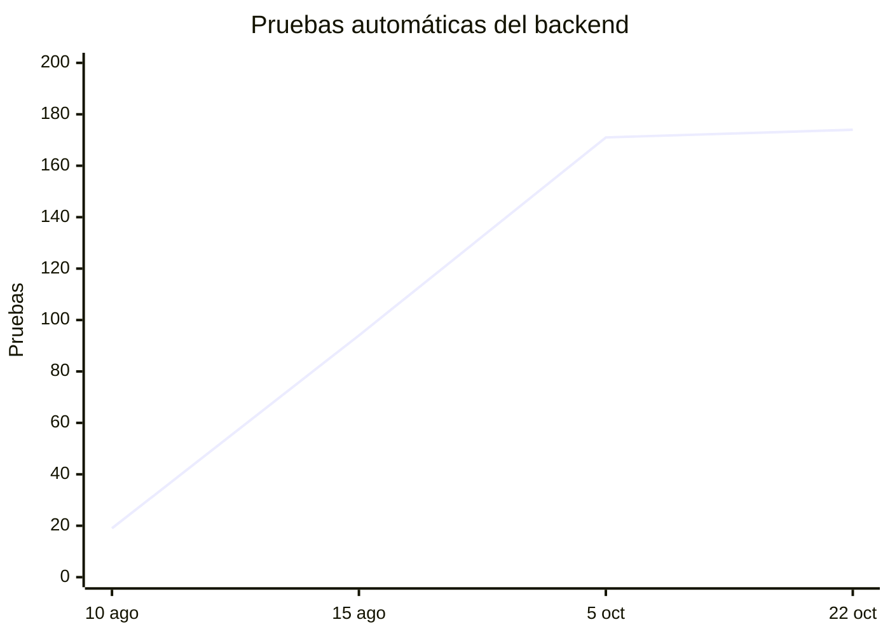

# 2. Línea del tiempo

Las fechas son reales. El ritmo del principio también, y merece una explicación: la primera semana avanzó muy deprisa porque trabajé con asistentes de IA como compañeros de programación y de discusión. Las decisiones de arquitectura las contrasté con dos asistentes distintos en varias rondas, pegando las respuestas de uno al otro y obligándome a defender o abandonar cada punto. Varias posiciones cambiaron por argumentos, no por cansancio. El código se escribió rápido; lo que tardó fue lo de después: usarlo de verdad, encontrar lo que faltaba y endurecerlo.

## Vista general

## En un diagrama de Gantt

## Cómo se repartió el trabajo

Commits por mes. Agosto concentra la construcción; septiembre y octubre son de uso real, pocas entregas pero más pensadas.

Y las pruebas automáticas del backend, que es lo que mejor cuenta cómo fue creciendo la confianza en el sistema:

## Los hitos, contados

**Día 1.** Cerré la arquitectura por la mañana y por la tarde ya existían los diez módulos de negocio con su API, su base de datos y una interfaz mínima. Se escribió deprisa porque el dominio ya estaba resuelto: era el mismo que el del sistema antiguo, y antes de empezar dejé escrito el mapeo de cada tabla vieja a su módulo nuevo.

**Día 2.** El día de la infraestructura. Permisos con nombre en lugar de roles literales, un segundo proveedor de identidad real (LDAP) para demostrar que el enchufe funcionaba, la forja Git con tres ramas protegidas, el CI construyendo y promoviendo imágenes, las primeras pruebas y las métricas. Y al final del día, el primer ensayo de migración de datos contra una copia: recuentos idénticos a producción.

**Días 3 a 5.** Aquí me di cuenta de algo incómodo, que cuento en [Tropiezos](06-tropiezos.md#el-sistema-nuevo-hacía-menos-que-el-viejo): el sistema nuevo era mejor por dentro, pero hacía menos cosas que el viejo. Me dediqué a recuperar todo lo que se había quedado por el camino y a rehacer el aspecto visual.

**Semana 2.** Primera pasada de seguridad, un módulo nuevo que el sistema antiguo no tenía (el reparto mensual de nóminas a cada trabajador) y el corte a producción. Ese mismo día, con todo verificado y una copia íntegra guardada, eliminé el sistema antiguo.

**Septiembre.** Uso real. Las peticiones dejan de ser mías y pasan a ser de la gente que lo usa: crear muchas órdenes de golpe a partir de un servicio recurrente, dar de alta un cliente sin salir del formulario, que el calendario recuerde los filtros.

**Octubre.** Un pentest, con hallazgos reales que se corrigieron y otros que resultaron falsos positivos. Después, una segunda tanda de endurecimiento de la infraestructura, adjuntos múltiples con permisos por perfil y las ausencias dentro del calendario de trabajo.

**Lo siguiente.** Está en la [hoja de ruta](09-hoja-de-ruta.md) y en el plan para [escalar y blindar](10-escalar-y-blindar.md) la plataforma.

---

Anterior: [Punto de partida](01-punto-de-partida.md) · Siguiente: [Arquitectura](03-arquitectura.md)
