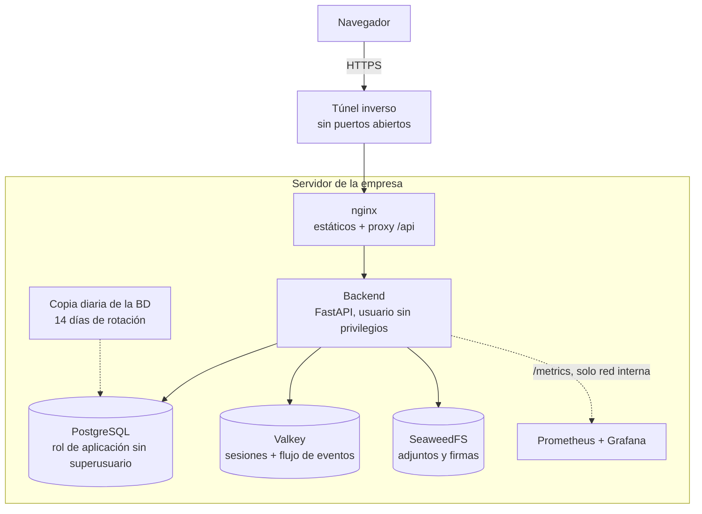
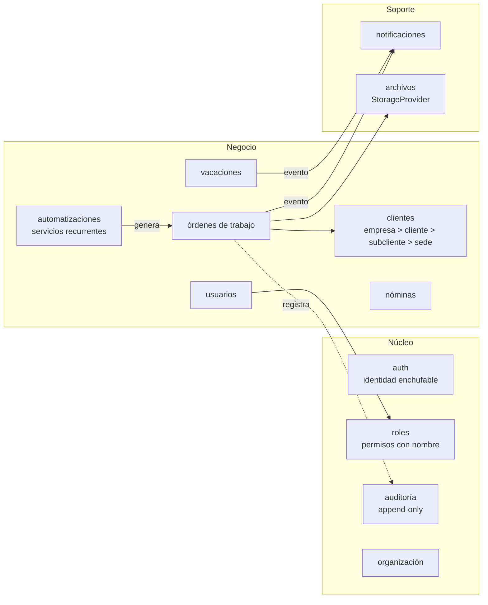
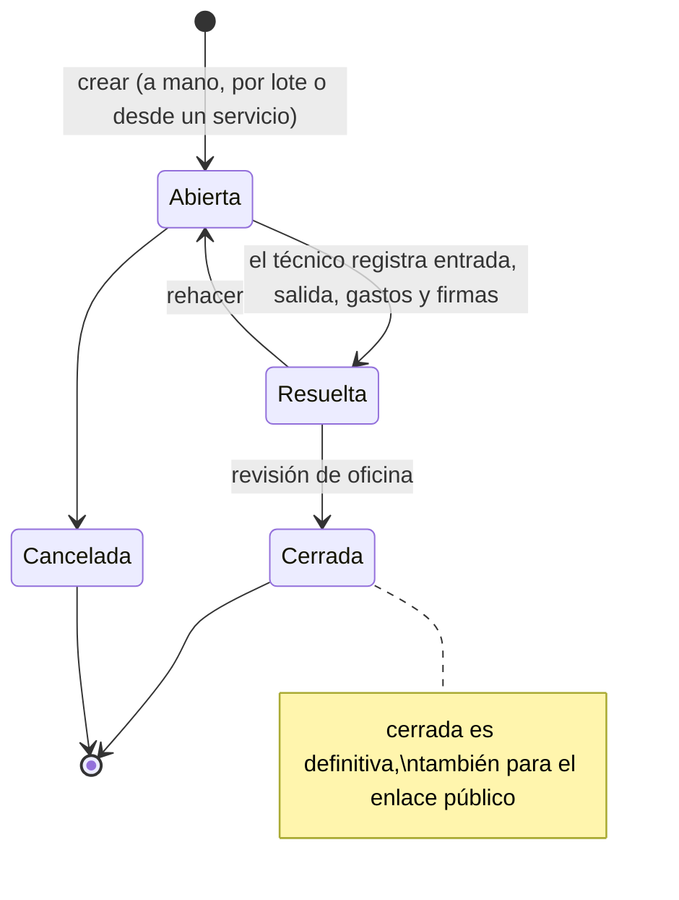
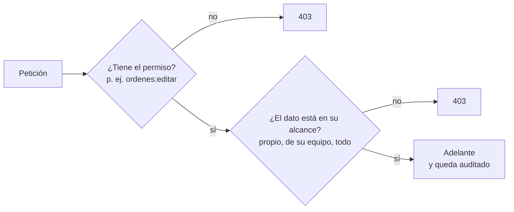
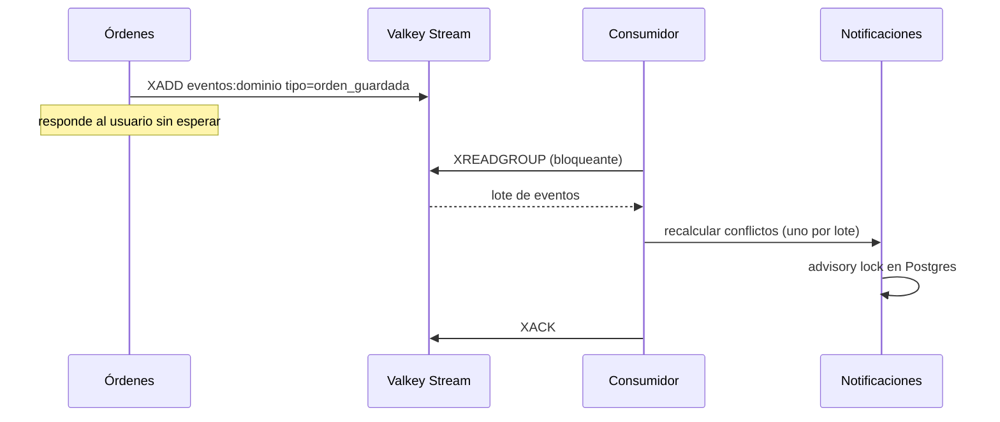
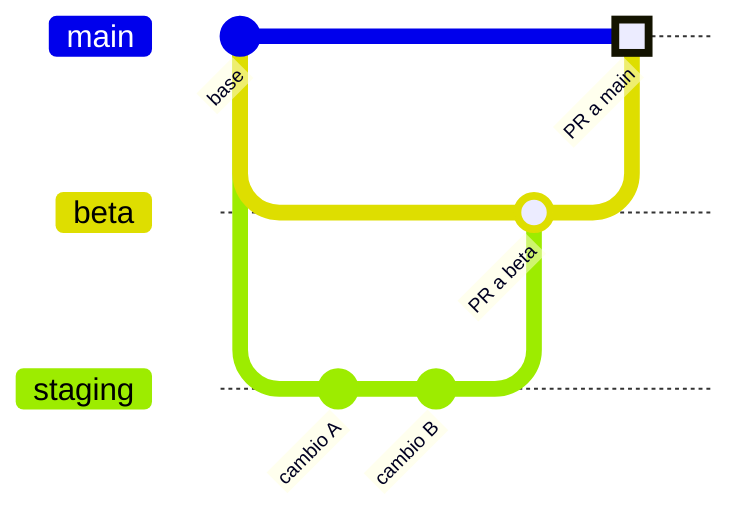
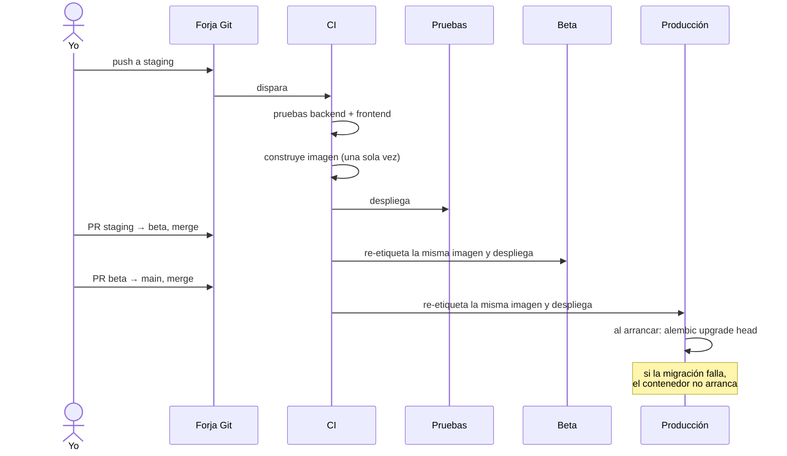

# 3. Arquitectura

Cada pieza tiene su porqué en el [registro de decisiones](decisiones/README.md). Aquí va la foto de conjunto.

## Vista de despliegue

Una instalación es un servidor con un `docker compose`. La instalación de la propia empresa es una más, idéntica a la que recibiría cualquier cliente.

Nada escucha en una IP pública. El único camino de entrada es el túnel, y las herramientas de administración solo son accesibles desde la propia máquina.

## Vista lógica: monolito modular

Un solo proceso, pero dividido en módulos que no se tocan las tripas. Cada módulo tiene sus modelos, su repositorio, sus servicios y su API. Si un módulo necesita algo de otro, llama a su servicio público o publica un evento. Nunca consulta sus tablas directamente.

Dos reglas que he intentado no romper:

1. **El dominio no conoce el framework.** Los servicios de negocio no importan nada de FastAPI. FastAPI solo expone endpoints.
2. **Cada módulo habla con sus datos por su repositorio.** Si algún día hace falta separar empresas dentro de una misma instalación, el filtro se añade en un sitio por módulo y no en cien consultas sueltas.

## El ciclo de vida de una orden de trabajo

El cliente puede firmar desde un enlace público con caducidad, sin cuenta. Ese enlace usa un esquema de datos propio, más pequeño: no ve importes ni datos internos.

## Permisos: rol, permiso y alcance

El sistema antiguo preguntaba "¿eres administrador?". El nuevo hace tres preguntas:

Los permisos se agrupan en roles editables desde la interfaz, y a una persona se le pueden dar permisos sueltos además de los de su rol. El alcance depende del tipo de rol: un técnico ve lo suyo, un supervisor lo de su equipo, administración todo.

## Eventos: el patrón outbox

El problema del sistema antiguo era que recalcular avisos dependía de que cada función se acordara de llamar al recálculo. Ahora los módulos publican un evento en un flujo de Valkey y un consumidor en segundo plano hace el trabajo.

Es "mejor esfuerzo" a propósito: el recálculo es idempotente y la siguiente escritura vuelve a publicar. Detalle en [ADR 0006](decisiones/0006-eventos-con-outbox.md).

## Auditoría

Una tabla donde solo se puede insertar. Un trigger de la base de datos rechaza cualquier `UPDATE` o `DELETE`, y cada fila guarda el hash de la anterior, así que alterar el historial sin dejar rastro es prácticamente imposible. Las ediciones guardan el diff de campos (antes y después).

La auditoría no guarda datos personales, solo identificadores. Así se puede borrar a una persona por una petición de protección de datos sin romper la cadena. Ver [ADR 0008](decisiones/0008-auditoria-encadenada.md). La demo tiene una pestaña que enseña cómo funciona.

## Entrega: tres entornos, una imagen

`beta` y `main` están protegidas: no admiten `push`, solo Pull Request. El PR no está para pedir permiso a nadie (somos muy pocos), sino porque deja escrito qué se promovió, cuándo y con qué pruebas en verde. El detalle:

La imagen se construye una vez y se promueve por etiqueta. Lo que llega a producción es, byte a byte, lo que pasó las pruebas. Lo comprobé comparando el identificador de la imagen en los tres entornos.

---

Anterior: [Línea del tiempo](02-linea-del-tiempo.md) · Siguiente: [La migración](04-migracion.md)
