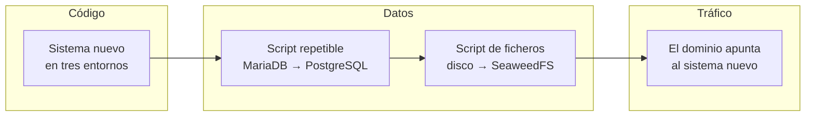
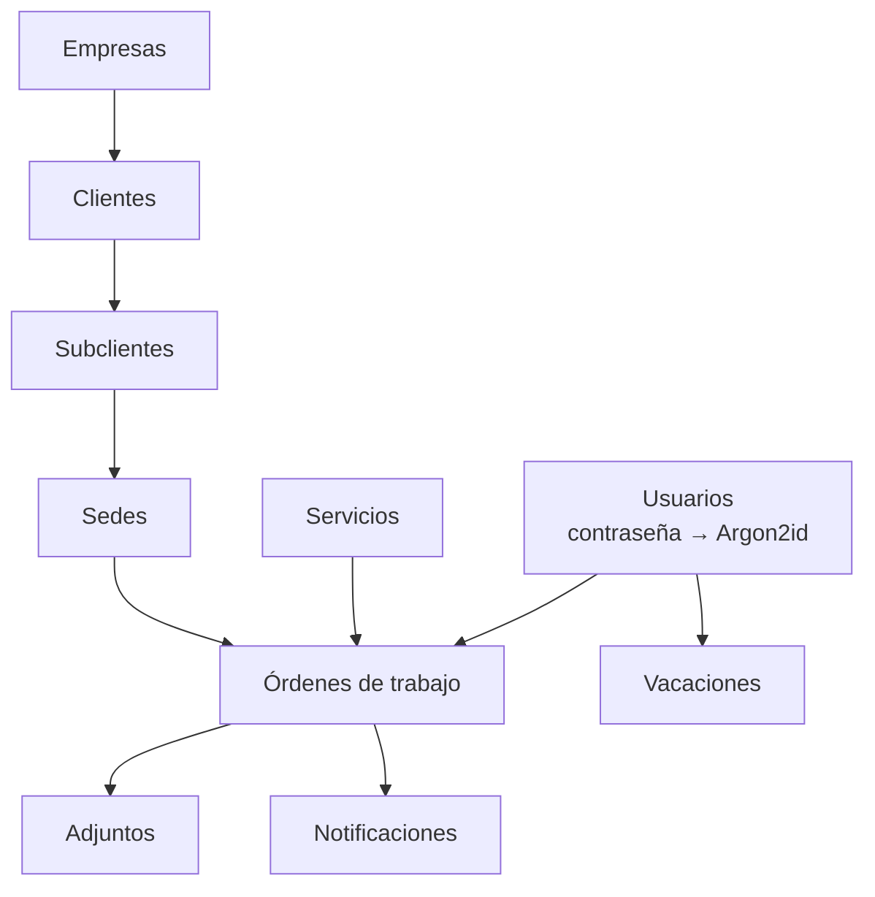
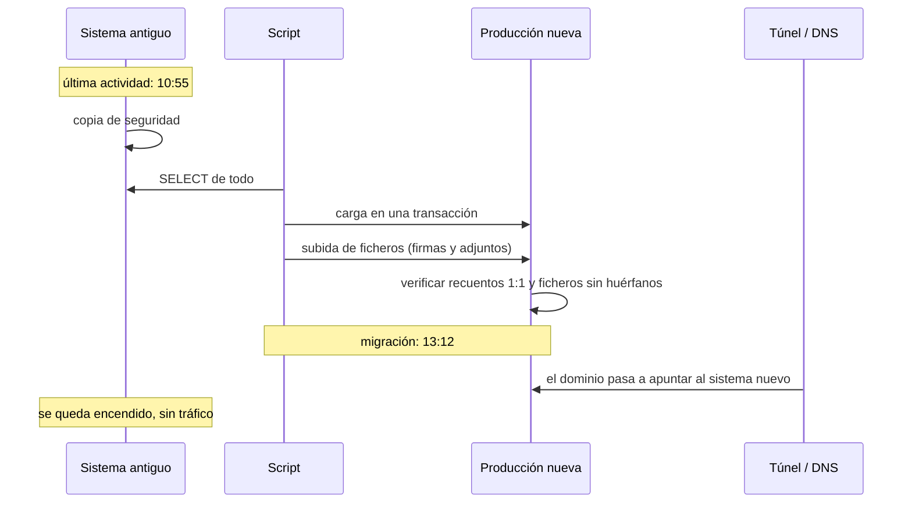
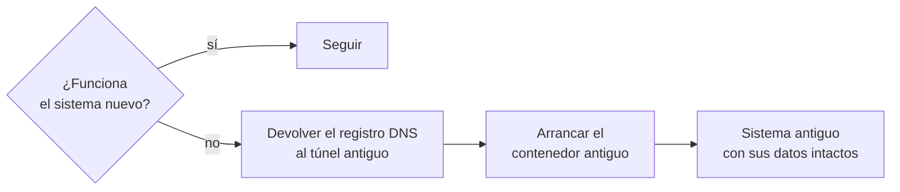

# 4. La migración

Pasar de un sistema a otro tiene tres partes que conviene no mezclar: el **código**, los **datos** y el **tráfico**. Las hice por separado y en ese orden.

## El script de datos

Un único script en Python que:

1. Lee las tablas de MariaDB **solo con `SELECT`**. Nunca escribe en el origen.
2. Vacía las tablas de negocio del destino (nunca las de auditoría, organización ni permisos).
3. Recarga todo generando identificadores nuevos (UUID) y mantiene un mapa de "id viejo → id nuevo" para resolver las relaciones en orden de dependencia.
4. Todo en una transacción. Si algo falla, no queda nada a medias.

### Las contraseñas

Las contraseñas venían en claro. El script calcula el hash Argon2id **una vez**, al migrar, y escribe solo el hash. El valor en claro no llega a existir en el sistema nuevo.

La alternativa típica es el "hash perezoso" (guardar el texto plano y convertirlo cuando la persona entra por primera vez). La descarté porque implica que el sistema nuevo almacene contraseñas en claro, aunque sea temporalmente, y yo quería que eso no pasara nunca. Resultado: cada persona entró al día siguiente con su contraseña de siempre, sin enterarse de nada.

### Cómo se ejecutó

En un contenedor de usar y tirar, conectado a la vez a la red del sistema antiguo y a la del nuevo. Una variable de entorno decide el destino, para que apuntar a producción tenga que ser un acto deliberado.

## El ensayo

El primer día de infraestructura ya corrí el script completo contra el entorno de pruebas. No contra producción: contra una copia.

Lo verifiqué en tres capas:

| Capa | Qué comprobé |
|---|---|
| Recuentos | Mismas filas por tabla que en origen |
| Integridad | Cero órdenes con cliente o técnico huérfano, cero sedes sin subcliente, cero correos duplicados |
| Distribución | Mismo reparto de estados y de tipos de tarifa que en origen |
| Uso real | Entrar con una cuenta migrada y navegar por la API y la interfaz |

Antes de ejecutarlo, un chequeo automático encontró un error que habría reventado a mitad: el `INSERT` de órdenes tenía 42 columnas y 42 valores, pero 41 marcadores `%s`. Lo cuento en [Tropiezos](06-tropiezos.md#42-columnas-41-huecos).

## El día del corte

Lo que tenía preparado si algo salía mal:

No hizo falta. Los recuentos cuadraron uno a uno, no hubo actividad en el sistema antiguo entre la última escritura y la migración, y el sistema nuevo respondió bien desde el primer minuto.

Hubo un susto: desde mi ordenador el dominio no cargaba y desde el móvil sí. Era la caché de DNS negativa del router, que había guardado el "no existe" de los segundos en que borré y recreé el registro. Cambiar el DNS del equipo y vaciar la caché lo resolvió. No era el sistema.

## Apagar lo viejo

El mismo día, con todo verificado, eliminé el sistema antiguo entero: contenedores, volúmenes, imágenes y directorios. Antes hice una copia íntegra (código, configuración y cada volumen) y comprobé que los ficheros comprimidos no estaban corruptos. Doble red: los datos ya vivían en el sistema nuevo y además había copia del viejo.

¿Por qué tan rápido? Porque tener dos sistemas encendidos invita a que alguien use el que no debe, y porque el plan de vuelta atrás ya no dependía de que estuviera encendido: dependía de la copia.

## Lo que viaja entre entornos y lo que no

Una regla que me costó dejar clara y que ahora está escrita:

- Entre `staging`, `beta` y `main` viaja el **código** y los **cambios de esquema** (migraciones).
- **Nunca viajan los datos.** Los entornos de prueba tienen datos de usar y tirar. Los reales viven solo en producción.
- Un cambio de estructura es una migración de Alembic en el código. Nadie edita la base de datos a mano.

---

Anterior: [Arquitectura](03-arquitectura.md) · Siguiente: [Seguridad](05-seguridad.md)
