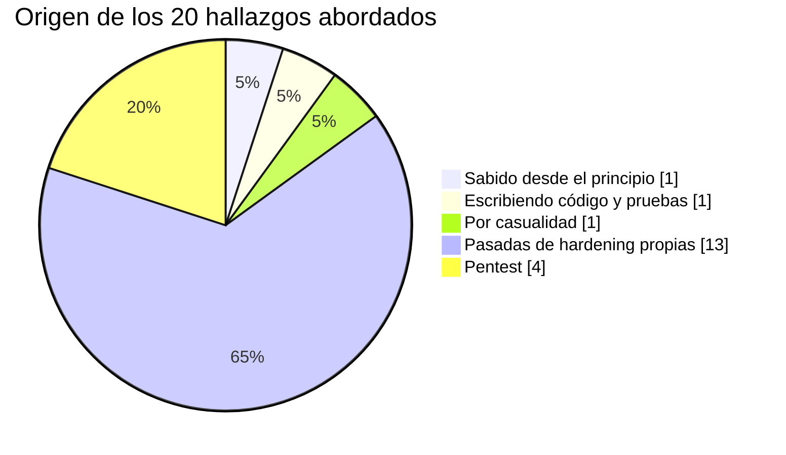
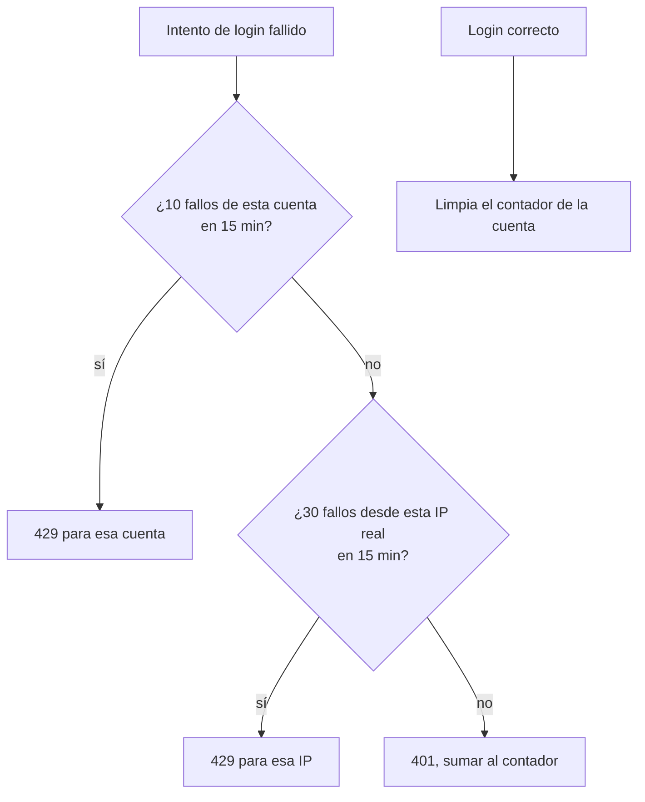
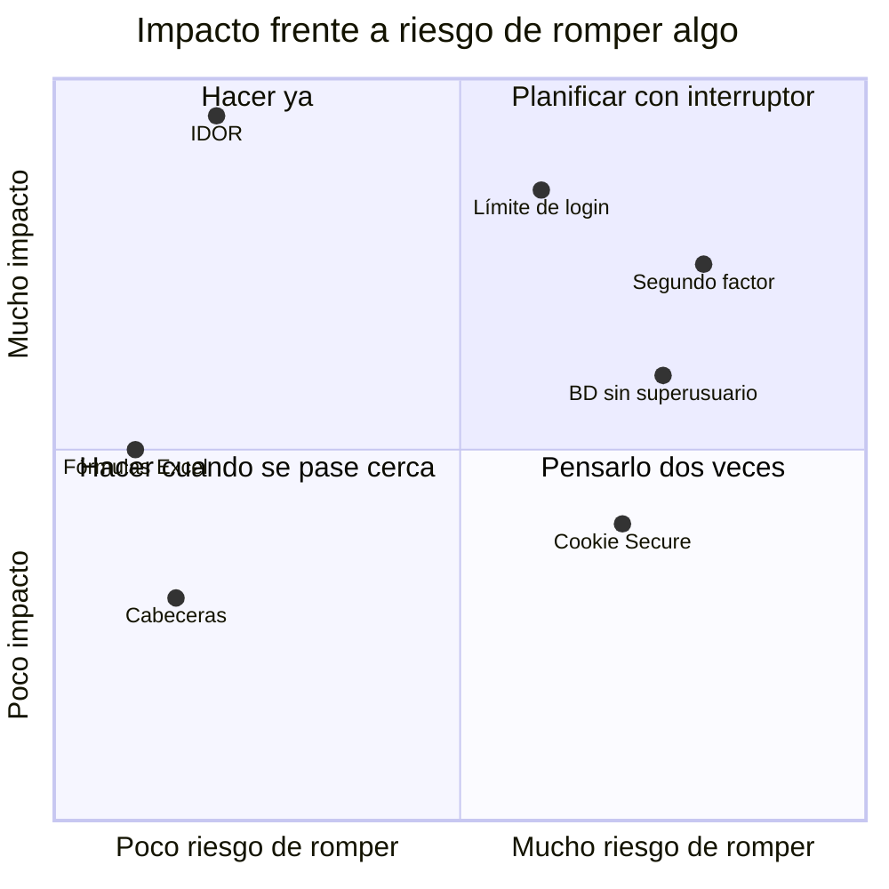

# 5. Seguridad

Este capítulo no es una lista de buenas prácticas. Es lo que encontré, cómo lo encontré y qué hice. Algunas cosas las descubrí yo, otras salieron en un pentest y alguna me la encontré por casualidad mientras arreglaba otra cosa.

## Cómo aparecieron los problemas

La lección que saco de este gráfico: dos de cada tres salieron de sentarme expresamente a buscar. No aparecen solos.

## Los que más me importaron

### Cualquier técnico podía leer cualquier orden

**Cómo se descubrió:** escribiendo los permisos finos.
**Qué pasaba:** el listado de órdenes filtraba bien (cada técnico veía las suyas), pero las rutas por identificador (`/ordenes/{id}`, resolver, subir adjunto, firmar, descargar el PDF) solo comprobaban que hubiera sesión. Con el identificador de otra orden, se podía ver y tocar. Lo mismo con las vacaciones de otras personas.
**Qué hice:** una comprobación común, "propio o con permiso", aplicada en todas esas rutas. Y una prueba por cada caso.

Es el clásico IDOR. Lo que me enseñó es que el filtro del listado da una falsa sensación de seguridad: la interfaz no te deja llegar, pero la API sí.

### Cerrar, cancelar y borrar sin mirar de quién era

**Cómo se descubrió:** pentest.
**Qué pasaba:** esas acciones comprobaban que tuvieras el permiso, pero no que la orden estuviera dentro de tu alcance. Un supervisor con permiso de cerrar podía cerrar órdenes de otro equipo.
**Qué hice:** el mismo criterio que ya usaba "resolver", aplicado también a las acciones masivas.

Es la misma familia que el anterior. Lo había arreglado en unas rutas y no en otras. Desde entonces, cuando arreglo un fallo de autorización, busco todas las rutas que hacen algo parecido antes de dar el arreglo por bueno.

### El directorio de usuarios contaba demasiado

**Cómo se descubrió:** pentest.
**Qué pasaba:** los desplegables para elegir técnico pedían la lista de usuarios, y la API devolvía la ficha completa: documento de identidad, fecha de nacimiento, tarifas. A cualquier sesión.
**Qué hice:** un esquema reducido (identificador, nombre, activo, rol) para todo el que no gestione usuarios o no sea la propia persona.

### Contraseñas en claro

Venía del sistema antiguo. Se resolvió en la migración, como cuento en [La migración](04-migracion.md#las-contraseñas). Argon2id, y el texto plano no llegó a existir en el sistema nuevo.

### Límite de intentos de login: por cuenta, no por IP

Este tiene una historia que me gusta porque la respuesta "de libro" era la equivocada.

Lo normal es limitar intentos por IP. Pero toda la oficina sale a internet por la misma IP y, detrás del proxy, el servidor ve todas las peticiones como si vinieran del mismo sitio. Un bloqueo por IP habría dejado fuera a la oficina entera porque una persona se equivocó cinco veces.

Primero puse el límite por cuenta. Después, en la segunda pasada, añadí uno por IP bastante más alto, para frenar el relleno de credenciales (muchas cuentas, pocas pruebas por cuenta), que el límite por cuenta no ve. Para eso hacía falta la IP real: la saca nginx de la cabecera del proxy y el backend solo se fía de ella si la petición llega desde la red privada. Arreglarlo también corrigió la IP que se guardaba en la auditoría, que hasta entonces era siempre la del proxy.

### Dependencias sin fijar

**Cómo se descubrió:** por casualidad. Reconstruí una imagen y se instalaron versiones mayores de dos librerías centrales sin que nadie lo pidiera.
**Qué hice:** separar las dependencias directas (lo que edito) del fichero congelado con las 54 dependencias exactas de la imagen que pasó el CI. Verifiqué que reconstruir desde él da exactamente lo mismo. Y `pip-audit` sin vulnerabilidades conocidas en ese momento.

## Todo lo demás, en una tabla

| Hallazgo | Riesgo | Qué se hizo | Estado |
|---|---|---|---|
| Contraseñas en claro | Alto | Argon2id en la migración | Hecho |
| IDOR en órdenes y vacaciones | Alto | Comprobación de propiedad en todas las rutas por id | Hecho |
| Acciones sin comprobar alcance | Alto | Mismo criterio que "resolver", también en lote | Hecho |
| Ficha completa de usuarios expuesta | Alto | Esquema reducido por defecto | Hecho |
| Login sin límite | Medio | Por cuenta y por IP real | Hecho |
| Dependencias sin fijar | Medio | Fichero congelado + `pip-audit` | Hecho |
| Enlace público mostraba campos internos | Medio | Esquema público propio, sin importes | Hecho |
| Edición de importes sin permiso específico | Medio | Comprobación propia en la actualización | Hecho |
| Inyección de fórmulas en Excel exportado | Medio | Escapar celdas que empiezan por `=`, `+`, `-`, `@` | Hecho |
| Adjuntos sin límite | Medio | Tamaño máximo, número máximo por orden, límite también en nginx | Hecho |
| CSP con `unsafe-inline` | Medio | Script del tema a fichero propio; cero violaciones en diez pantallas | Hecho |
| Backend como root en el contenedor | Medio | Usuario sin privilegios | Hecho |
| Base de datos con superusuario | Medio | Rol propio de la aplicación, dueño solo de su esquema | Hecho |
| Valkey sin contraseña | Medio | Contraseña obligatoria si está configurada | Hecho |
| Documentación de la API pública | Bajo | Apagada salvo que se active a propósito | Hecho |
| Cabeceras (HSTS, nosniff, Referrer, X-Frame) | Bajo | Añadidas en nginx | Hecho |
| Cookie de sesión sin `Secure` | Bajo | Configurable por entorno, activa en producción | Hecho |
| Imagen de directorio LDAP sin parches | Bajo | Pasa a opcional, ningún entorno la usa | Hecho |
| Servidor web y Node sin parches | Bajo | Actualizados a ramas con soporte | Hecho |
| Token de la forja legible en la URL del remoto | Medio | Movido a un almacén de credenciales con permisos 600 | Rotación pendiente |
| Tipos de archivo permitidos en adjuntos | Bajo | Falta acordar la lista | Pendiente |
| Segundo factor para administradores | Medio | Recomendado, sin implementar | Pendiente |

## Cómo decidí qué hacer primero

En la primera pasada separé lo que se podía arreglar sin cambiar el comportamiento para nadie de lo que sí lo cambiaba (login, sesiones, base de datos). Lo primero lo hice ya. Lo segundo lo dejé con un plan escrito y un interruptor, y lo activé después, cuando pude probarlo con calma. Así nunca tuve que elegir entre seguridad y que la oficina pudiera trabajar ese día.

## Los falsos positivos

El pentest trajo más hallazgos de los que aparecen aquí. El resto los verifiqué uno a uno y no eran explotables. No los listo porque no aportan, pero sí quiero dejar constancia de que se miraron todos.

---

Anterior: [La migración](04-migracion.md) · Siguiente: [Tropiezos](06-tropiezos.md)
