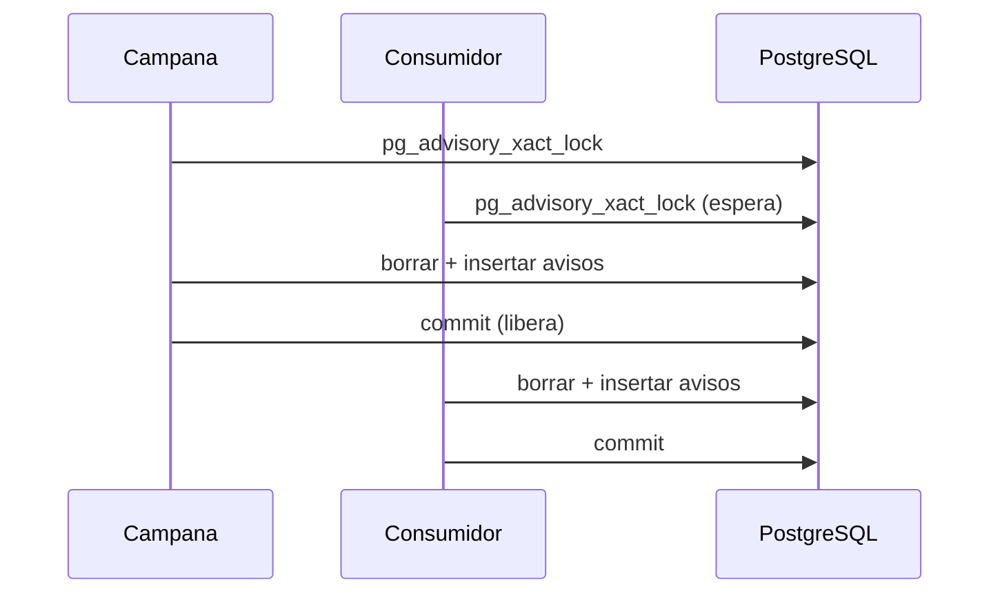

# 6. Tropiezos

Formato de postmortem sin culpables: qué pasó, por qué, qué hice y qué me llevo. Ninguno llegó a costar datos. Alguno sí costó una tarde.

Los ordeno de más a menos importante para mí, no por fecha.

| # | Tropiezo | Dónde | Tipo |
|---|---|---|---|
| 1 | [El sistema nuevo hacía menos que el viejo](#el-sistema-nuevo-hacía-menos-que-el-viejo) | Proceso | Alcance |
| 2 | [42 columnas, 41 huecos](#42-columnas-41-huecos) | Migración | Datos |
| 3 | [Desplegar un cambio de esquema daba 500](#desplegar-un-cambio-de-esquema-daba-500) | Entrega | Infraestructura |
| 4 | [Dos procesos recalculando lo mismo a la vez](#dos-procesos-recalculando-lo-mismo-a-la-vez) | Avisos | Concurrencia |
| 5 | [El CI dejaba de existir en beta y main](#el-ci-dejaba-de-existir-en-beta-y-main) | CI | Herramienta |
| 6 | [La hora salía dos horas tarde](#la-hora-salía-dos-horas-tarde) | Interfaz | Zonas horarias |
| 7 | [Un desplegable atrapado debajo de una tarjeta](#un-desplegable-atrapado-debajo-de-una-tarjeta) | Interfaz | CSS |
| 8 | [nginx se quedaba con la IP vieja del backend](#nginx-se-quedaba-con-la-ip-vieja-del-backend) | Infraestructura | Red |
| 9 | [Un nombre de red que significaba dos cosas](#un-nombre-de-red-que-significaba-dos-cosas) | Migración | Red |
| 10 | [Otros más pequeños](#otros-más-pequeños) | Varios | Varios |

---

## El sistema nuevo hacía menos que el viejo

**Qué pasó.** Tras la primera semana, el sistema nuevo era más ordenado, más seguro y más fácil de ampliar. Y aun así, al comparar pantalla con pantalla, hacía menos cosas que el antiguo: filtros más pobres, desplegables sin buscador, un registro de auditoría que solo cubría el login, el resumen de vacaciones de un solo usuario cuando antes era de varios, un calendario de ausencias que directamente no estaba.

**Por qué.** Ninguna de esas decisiones era mala por separado. Cada una tenía su comentario en el código explicando por qué se simplificaba "de momento". El problema es que nadie las sumó. Estaba midiendo el progreso por fases cerradas y por cosas fáciles de verificar (una petición que devuelve 200, una prueba en verde) en lugar de por lo que de verdad se había pedido: hacer todo lo que hacía el viejo, y más.

Lo descubrí comparando pantallas a mano, no porque nada me avisara. Y la primera vez que lo intenté arreglar, lo hice cambiando los componentes compartidos y dando por hecho que el cambio llegaba a todas partes. No llegó a todas. Hizo falta recorrer cada pantalla, una por una, para encontrar las tres que se habían quedado fuera.

**Qué hice.** Leí las plantillas del sistema antiguo enteras, no de memoria, y fui pantalla por pantalla apuntando lo que faltaba. Recuperé todo.

**Qué me llevo.** Simplificar la arquitectura especulativa está bien. Entregar menos de lo que ya existía, sin decirlo, no. Ahora, antes de dar algo por terminado, lo comparo con la referencia que importa y digo en voz alta lo que no he igualado. Y "se hereda por CSS" no es lo mismo que "lo he visto en cada pantalla".

---

## 42 columnas, 41 huecos

**Qué pasó.** El `INSERT` de órdenes de trabajo en el script de migración tenía 42 columnas, 42 valores y 41 marcadores `%s`.

**Por qué.** Una consulta larga escrita a mano. Se pierde uno.

**Qué hice.** No llegó a ejecutarse. Antes de lanzar el script escribí un chequeo pequeño que recorre el código con `ast` y, por cada `execute()`, cuenta columnas, marcadores y valores. Saltó en ese `INSERT`. Corregido y vuelto a chequear antes de tocar ninguna base de datos.

**Qué me llevo.** Para un script que solo se ejecuta "de verdad" una vez, merece la pena un chequeo que se ejecute antes que él. Cinco minutos de código me ahorraron una migración a medias.

---

## Desplegar un cambio de esquema daba 500

**Qué pasó.** Un despliegue con una columna nueva dejaba la aplicación respondiendo error 500: el código nuevo buscaba una columna que la base de datos aún no tenía.

**Por qué.** El despliegue hacía `docker compose up -d` y ya. Las migraciones había que lanzarlas a mano, y se me olvidó.

**Qué hice.** El contenedor del backend ejecuta `alembic upgrade head` al arrancar, antes de servir nada. Si la migración falla, el contenedor no arranca: mejor caído y avisando que vivo y roto. Lo comprobé cuando producción pasó ella sola de la migración 10 a la 24 al recibir un merge.

**Qué me llevo.** Lo que depende de acordarse, se olvida. Si un paso es obligatorio, que sea parte del proceso.

---

## Dos procesos recalculando lo mismo a la vez

**Qué pasó.** De vez en cuando, al abrir la campana de avisos, error 500. Otras veces desaparecía un aviso que se acababa de crear.

**Por qué.** El aviso de "técnico con trabajo un día que está de vacaciones" se recalculaba en dos sitios: al abrir la campana y en el consumidor de eventos en segundo plano. Si coincidían, los dos borraban y volvían a insertar a la vez. Inserción duplicada (el 500) o un borrado que se comía lo que el otro acababa de crear.

**Qué hice.** El recálculo toma un *advisory lock* de PostgreSQL. Uno espera al otro.

**Qué me llevo.** "Es idempotente" no significa "se puede ejecutar dos veces a la vez".

---

## El CI dejaba de existir en beta y main

**Qué pasó.** Separé las pruebas del frontend en un trabajo de CI propio y el despliegue pasó a depender de él. En `staging`, perfecto. En `beta` y `main`, donde las pruebas se saltan porque la imagen ya viene probada, la forja dejaba de crear ninguna ejecución. Ni éxito ni fallo. Nada. Sin errores en ningún log.

**Por qué.** No lo sé con certeza. La combinación de un trabajo que depende de otro y una condición cuando el primero queda "saltado" no se comportaba como esperaba en esa versión. Lo reproduje dos veces seguidas antes de descartar la casualidad.

**Qué hice.** No perseguí la causa raíz. Volví a un único trabajo con pasos condicionales por rama, el mismo patrón que ya funcionaba. Igual de correcto, más aburrido.

**Qué me llevo.** A veces la mejor decisión de depuración es dejar de depurar. Si hay una forma igual de buena que ya funciona, el bug ajeno se apunta y se rodea.

---

## La hora salía dos horas tarde

**Qué pasó.** La fecha de realización de una orden se veía dos horas desplazada en el listado y en el calendario.

**Por qué.** La hora se guarda como "hora de pared" (lo que pone en el reloj del sitio), pero el frontend la pasaba por `new Date()` y luego la formateaba con la zona del navegador. Conversión doble.

**Qué hice.** Leer los dígitos directamente de la cadena ISO para todo lo que es hora de pared. Tres funciones pequeñas y ningún `Date` de por medio.

**Qué me llevo.** Antes de tocar fechas, decidir qué es cada una: un instante o una hora de pared. Son tipos distintos aunque se escriban igual.

---

## Un desplegable atrapado debajo de una tarjeta

**Qué pasó.** El menú de un selector con buscador se pintaba por debajo de la tarjeta siguiente del formulario. Subirle el `z-index` no servía de nada.

**Por qué.** Para que un brillo decorativo de las tarjetas quedara detrás del contenido, todos los hijos directos de una tarjeta tenían `position: relative; z-index: 2`. Eso crea un *stacking context* nuevo en cada hijo. El menú quedaba atrapado dentro del suyo y no podía pasar por encima de la tarjeta hermana, tuviera el `z-index` que tuviera.

**Qué hice.** El brillo y la barra de color pasaron de pseudoelementos con `z-index` a capas de `background`. Sin `z-index` en los hijos, el problema desaparece. De paso quité un `overflow: hidden` que ya no hacía falta y que recortaba menús largos.

**Qué me llevo.** Cuando subir el `z-index` no funciona, el problema no es el número.

---

## nginx se quedaba con la IP vieja del backend

**Qué pasó.** Al recrear solo el contenedor del backend, la API respondía 502 hasta que reiniciaba también el frontend.

**Por qué.** nginx resuelve el nombre del `proxy_pass` una vez al arrancar y guarda la IP. El backend nuevo tenía otra.

**Qué hice.** Usar el resolver DNS de Docker y poner el destino en una variable, que obliga a nginx a resolver en cada petición.

---

## Un nombre de red que significaba dos cosas

**Qué pasó.** Durante la migración, el contenedor puente decía "conexión rechazada" al hablar con PostgreSQL.

**Por qué.** Estaba conectado a la red del sistema antiguo y a la del nuevo, y en las dos la base de datos se llamaba `db`. Resolvía a MariaDB. Hablar PostgreSQL contra un puerto de MariaDB no funciona.

**Qué hice.** Usar el nombre completo del contenedor, que es único.

---

## Otros más pequeños

- **Pruebas que fallaban a la segunda.** Los clientes de base de datos y de Valkey se creaban al importar el módulo, atados al bucle de eventos de la primera prueba. Con un bucle por prueba, la segunda encontraba el bucle cerrado. Solución: un único bucle para toda la sesión de pruebas.
- **Un orden de rutas que importa.** `GET /ordenes/exportar` daba 422 porque estaba declarada después de `GET /ordenes/{id}`, y FastAPI intentaba leer "exportar" como identificador. Las rutas literales van antes.
- **Un botón que se quedaba en "Duplicando...".** Al navegar entre dos órdenes, React Router reutiliza el componente sin desmontarlo, y el estado se arrastraba. Reiniciarlo antes de navegar.
- **Un comando bloqueante en un cliente compartido.** El consumidor de eventos espera cinco segundos a que llegue algo; con el cliente de Valkey compartido (y su *timeout* corto) daba error en bucle. Cliente propio con un *timeout* mayor que la espera.
- **Ficheros fantasma.** Copiar un fichero al servidor dando solo el directorio de destino lo dejó en la raíz del proyecto en vez de en su subcarpeta. El build se quejó de un módulo que no encontraba. Me pasó dos veces. Siempre ruta completa.
- **Una prueba que pasaba por casualidad.** Buscaba una cifra en la respuesta y la encontraba, sí, pero dentro de un UUID. Ahora busca el importe con su formato.

---

Anterior: [Seguridad](05-seguridad.md) · Siguiente: [Impacto](07-impacto.md)
