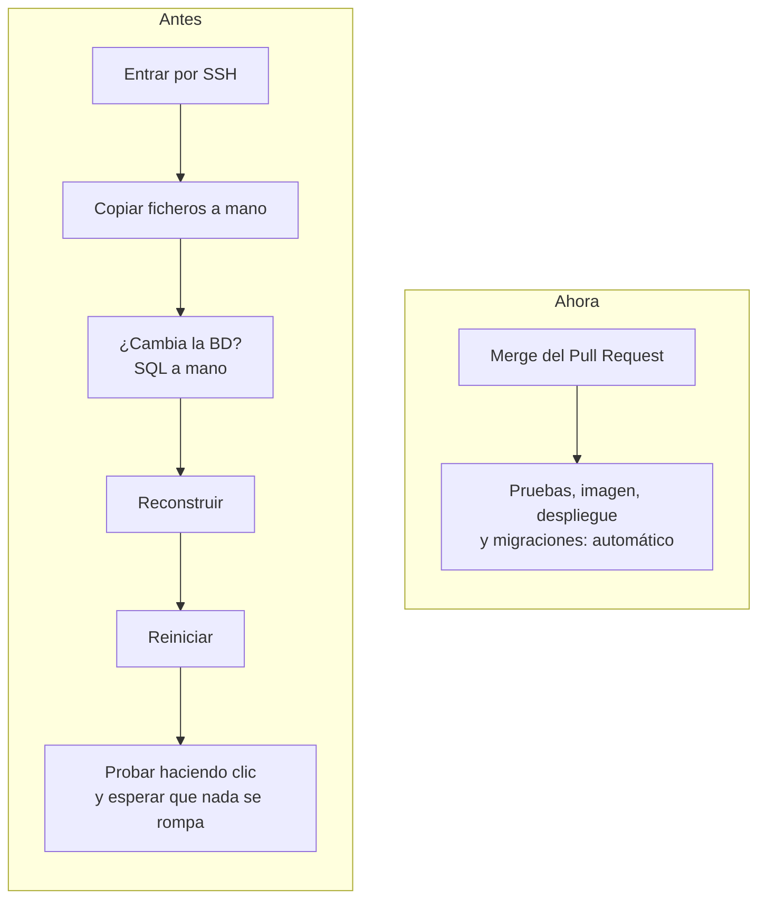
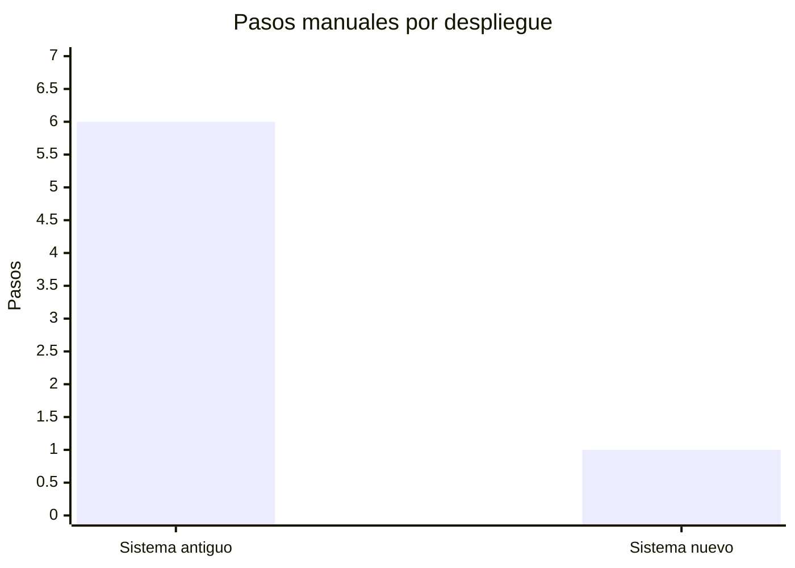
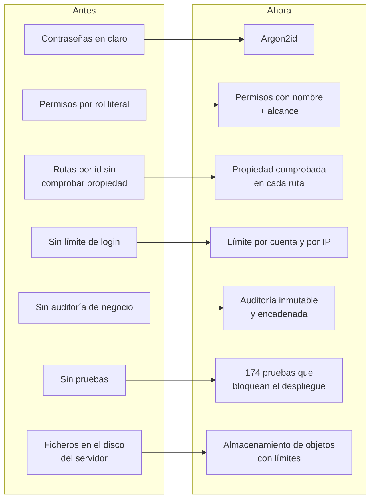

# 7. Impacto

El sistema está terminado y en producción. Lo usa toda la empresa cada día: oficina, supervisores y técnicos. El antiguo ya no existe.

Una advertencia antes de seguir: no medí tiempos por tarea antes del cambio, así que no voy a poner porcentajes de productividad inventados. Lo que sí puedo enseñar es qué pasos han desaparecido, qué se hace ahora solo y qué se puede controlar que antes no. Eso es verificable.

## Productividad

### Primero, no perder nada

Antes de hablar de mejoras: el sistema antiguo ya hacía mucho. Creaba órdenes a partir de servicios recurrentes, permitía altas rápidas de clientes y sedes sin salir del formulario, tenía enlace público para que el cliente firmara, generaba el parte en PDF, avisaba de conflictos con vacaciones y aceptaba varios adjuntos a la vez. Todo eso sigue estando, y comprobarlo pantalla por pantalla fue parte del trabajo (ver [Tropiezos](06-tropiezos.md#el-sistema-nuevo-hacía-menos-que-el-viejo)). La gente no tuvo que aprender a trabajar de otra manera.

### Lo que ahora se hace más rápido o sin pensar

| Tarea | Antes | Ahora |
|---|---|---|
| Crear varias órdenes parecidas | Por técnico o por fechas sueltas | Además, por lote con una parte común y lo distinto en cada una, o por rango de fechas, con hora en cada orden |
| Repartir las nóminas del mes | La sección existía pero estaba vacía ("Próximamente") | Se suben una vez y cada trabajador ve solo las suyas, mes a mes |
| Ver quién está de vacaciones al planificar | Pantalla aparte | Las ausencias aparecen dentro del propio calendario de trabajo, en día, semana y mes |
| Exportar órdenes a Excel | Selección de campos | Catálogo de campos revisado, fechas elegidas en calendario y celdas protegidas contra fórmulas |
| Dar permisos a alguien | Tocar código | Desde la interfaz, por rol o por persona |
| Saber si una mejora ya está en producción | Preguntarme | El historial de Pull Requests lo dice |

La mayoría de estas mejoras no las pensé yo: salieron de ver a la gente usar el sistema en septiembre. Que pedirlas fuera rápido y entregarlas también (ver abajo) es parte del impacto.

### Desplegar dejó de ser una tarea

Esto es lo que más tiempo me ha devuelto a mí, y por extensión a la empresa, porque cada mejora llega antes.

Y con red: si una migración falla, el contenedor no arranca y producción sigue con la versión anterior. Antes, un fallo a mitad de un despliegue manual dejaba las cosas como quedaran.

## Control

Lo que la dirección puede saber hoy y antes no:

- **Quién hizo qué, y qué cambió exactamente.** Cada acción de negocio queda en una auditoría a la que no se le puede borrar ni editar nada, y las ediciones guardan el antes y el después de cada campo.
- **Quién cambió el código y cuándo llegó a producción.** Un segundo rastro, separado del anterior: el historial de Pull Requests con el resultado de las pruebas en cada promoción.
- **Quién puede hacer qué.** Los roles se editan desde la interfaz, con permisos con nombre. Dar un permiso concreto a una persona concreta ya no requiere tocar código.
- **Qué ve cada uno.** Un técnico ve lo suyo, un supervisor lo de su equipo, administración todo. Y lo aplica la API, no solo la pantalla.
- **Cómo está el sistema.** Métricas de peticiones, errores y tiempos de respuesta por entorno, en un panel.

## Seguridad

El detalle está en [Seguridad](05-seguridad.md). De antes a ahora, de un vistazo:

Además: un pentest externo pasado con los hallazgos reales corregidos, la base de datos sin superusuario, contenedores sin root, dependencias congeladas y auditadas, cabeceras de seguridad y CSP estricta. Copias diarias de la base de datos con dos semanas de rotación.

## Lo que no he medido y cómo lo mediría

Para no quedarme en lo cualitativo, si tuviera que demostrarlo con números:

1. **Tiempo de creación de órdenes recurrentes.** La auditoría registra cuándo se crea cada orden y por quién. Comparar cuánto tarda la oficina en preparar el mes ahora frente a una estimación del método anterior.
2. **Tiempo desde que alguien pide algo hasta que lo tiene.** El historial de Pull Requests da la fecha de cada entrega a producción.
3. **Conflictos de agenda detectados.** Los avisos de técnico con trabajo en un día de vacaciones quedan registrados. Antes no había forma de contarlos.

No lo he hecho todavía. Lo dejo escrito para no venderlo como si lo hubiera hecho.

---

Anterior: [Tropiezos](06-tropiezos.md) · Siguiente: [Lo aprendido](08-lecciones.md)
