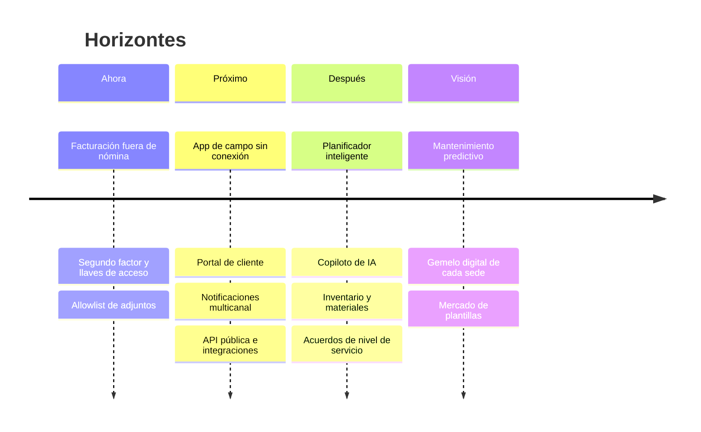
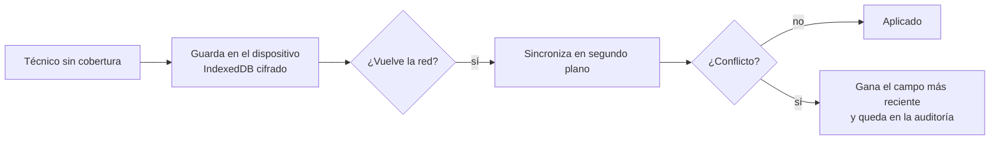
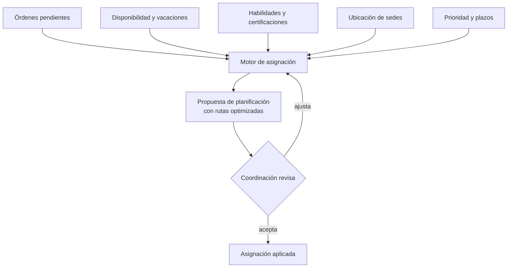

# 9. Hoja de ruta

Lo que viene. **Nada de este capítulo está construido todavía**: es la dirección en la que quiero llevar el producto, ordenada por horizontes. Lo que ya funciona está en [El producto](00-producto.md).

## Ahora

### Facturación fuera de nómina
La sección ya existe en el menú, vacía. Recogerá lo que se paga a cada persona fuera de la nómina: lo que facturan los autónomos y las dietas, gastos y kilómetros de los internos, calculado a partir de las órdenes resueltas del mes. Cierre mensual con aprobación de supervisión y exportación para contabilidad.

### Segundo factor y llaves de acceso
TOTP para todo el mundo y **passkeys (WebAuthn)** como opción preferente. Obligatorio para cualquier rol con permisos de administración. Códigos de recuperación de un solo uso.

### Allowlist de tipos de archivo
Solo los tipos que se usan de verdad (PDF, imágenes, documentos de ofimática), comprobados por contenido y no por extensión.

## Próximo

### App de campo sin conexión
Una aplicación web instalable (PWA) pensada para el técnico, que funcione en un sótano sin cobertura:

- Órdenes del día descargadas al empezar la jornada.
- Fotos con compresión en el propio dispositivo.
- Registro de entrada y salida con geolocalización opcional y geocerca de la sede.
- Dictado por voz de la resolución.
- Escáner de códigos QR pegados en los equipos de cada sede para abrir su historial.

### Portal de cliente
Un espacio para el cliente final, con su propio acceso:
- Historial de intervenciones en sus sedes, con los partes firmados.
- Solicitud de servicio con fotos, que entra como orden pendiente de planificar.
- Valoración de cada intervención.
- Descarga de certificados y documentación.

### Notificaciones multicanal
Correo, notificaciones push de la app y mensajería instantánea. Cada persona elige qué quiere recibir y por dónde. Recordatorios al técnico la víspera, aviso al cliente cuando el técnico va de camino.

### API pública e integraciones
- API documentada con OAuth 2.0 y claves por integración, con permisos acotados.
- **Webhooks** firmados para cada evento de dominio (orden creada, resuelta, cerrada).
- Conectores con programas de contabilidad y ERP, y sincronización con calendarios externos.
- Importación masiva de clientes y sedes desde hojas de cálculo.

## Después

### Planificador inteligente
Hoy la asignación es manual. El siguiente paso es que la plataforma **proponga** la planificación:

- Optimización de rutas diarias por técnico para reducir kilómetros.
- Reasignación automática cuando alguien se pone de baja, con propuesta de sustituto.
- Simulación: "¿qué pasa si este técnico se va de vacaciones la semana 32?".

### Copiloto de IA
Asistencia, no automatización a ciegas. Siempre con una persona confirmando:
- **Búsqueda en lenguaje natural**: "órdenes cerradas en sedes de hostelería el mes pasado con más de 50 km".
- **Resumen del historial** de una sede antes de la visita.
- **Redacción asistida** del parte a partir de notas de voz.
- **Detección de anomalías** en gastos y kilometraje frente a lo habitual de cada ruta.
- Clasificación automática de las solicitudes que llegan del portal de cliente.

Los datos no salen de la instalación del cliente: modelos locales o proveedores con contrato de tratamiento, según elija cada empresa.

### Inventario y materiales
Material consumido por orden, existencias por almacén y furgoneta, avisos de reposición y coste real de cada intervención.

### Acuerdos de nivel de servicio
Plazos de respuesta y resolución por contrato de cliente, con semáforo en el listado, escalado automático cuando se acerca el límite e informes de cumplimiento mensuales.

### Analítica
Paneles de productividad por técnico y por cliente, tiempos medios por tipo de intervención, rentabilidad por contrato y previsión de carga de trabajo. Exportables y con acceso según rol.

## Visión

- **Mantenimiento predictivo**: con suficiente historial por equipo, anticipar averías y proponer visitas antes de que ocurran.
- **Gemelo digital de cada sede**: planos, equipos instalados, historial completo y documentación en un solo sitio.
- **Mercado de plantillas**: servicios recurrentes, checklists e informes predefinidos por sector, compartibles entre instalaciones.
- **Multidioma y multimoneda** para empresas con presencia en varios países.
- **Accesibilidad AA** verificada en cada pantalla.

## Cómo se decide qué va primero

Cada propuesta pasa por las mismas tres preguntas antes de entrar en un horizonte:

1. ¿Quita trabajo manual que hoy se hace cada semana?
2. ¿Reduce un riesgo (de seguridad, de datos o de negocio) que ya existe?
3. ¿Se puede construir sin romper el modelo de una instalación por empresa?

Lo que no responde "sí" a al menos una espera.

---

Anterior: [Lo aprendido](08-lecciones.md) · Siguiente: [Escalar y blindar](10-escalar-y-blindar.md)
