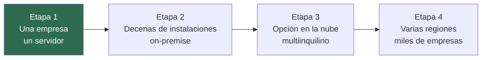
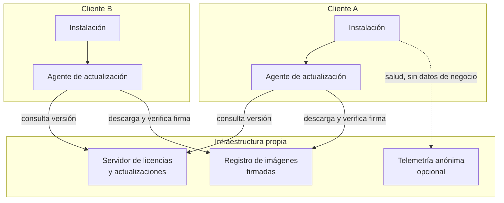
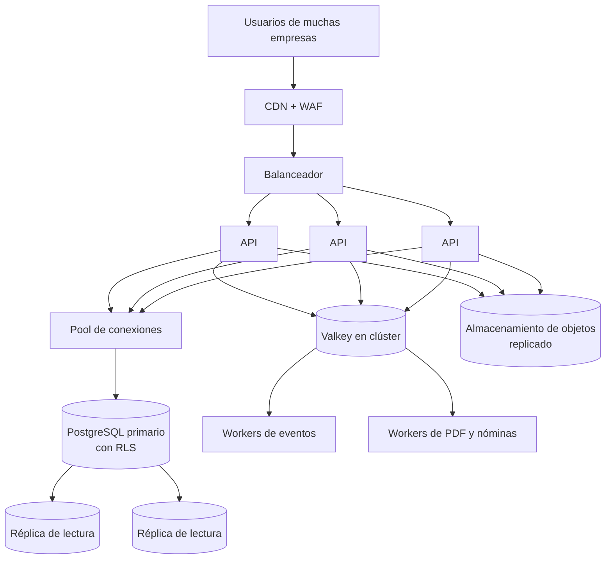
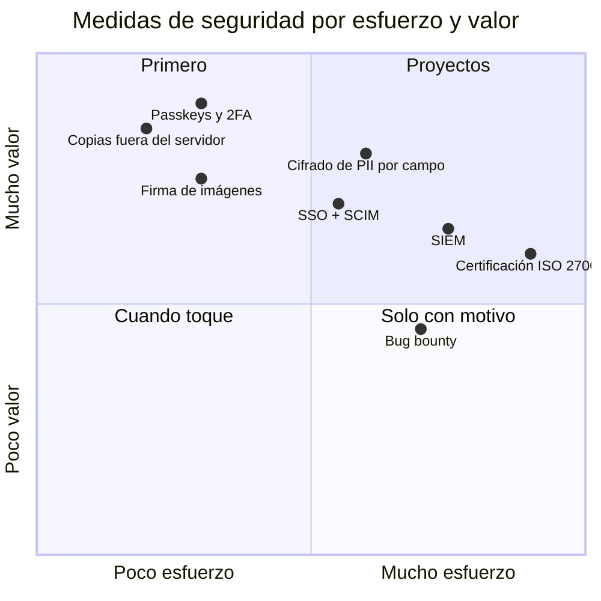

# 10. Escalar y blindar

Cómo llevar esta plataforma de una empresa a miles, y cómo protegerla a esa escala. Como la [hoja de ruta](09-hoja-de-ruta.md), **esto es un plan, no algo construido**. Lo que sí está hecho es la base que lo hace posible: módulos con fronteras claras, patrón repositorio, identidad enchufable, imágenes inmutables y migraciones automáticas.

## Las cuatro etapas

La etapa 1 es la actual. Cada etapa siguiente solo se aborda cuando la anterior se queda corta de verdad, no antes.

### Etapa 2: decenas de instalaciones en casa de clientes

El reto deja de ser el rendimiento y pasa a ser **mantener muchas instalaciones iguales sin acceso directo a ellas**.

- **Imágenes firmadas** y verificadas antes de instalarse, con su lista de componentes (SBOM).
- **Agente de actualización** en cada cliente: comprueba versión, hace copia de la base de datos, actualiza y, si falla el arranque, vuelve a la versión anterior solo.
- **Canales de versión**: estable, anticipada y soporte extendido, para que cada cliente elija su ritmo.
- **Licencias firmadas** en el punto de extensión que ya existe en el arranque.
- **Personalización por cliente** (colores, logo, plantilla del parte) como configuración, nunca como rama de código.
- **Asistente de instalación** que valida requisitos, genera secretos y deja la primera copia programada.

### Etapa 3: opción en la nube, multiinquilino

Para empresas que no quieran gestionar su propio servidor. Aquí entra el diseño que se descartó en el [ADR 0002](decisiones/0002-una-instalacion-por-empresa.md), y entra fácil precisamente porque se preparó el terreno:

- El filtro por empresa se añade **en el repositorio de cada módulo**, un sitio por módulo.
- **Seguridad a nivel de fila** en PostgreSQL como segunda barrera: aunque una consulta olvide el filtro, la base de datos no devuelve filas de otra empresa.
- La entidad `organización` ya existe como raíz del dominio desde el primer día.
- Inquilinos grandes pueden tener **base de datos propia** dentro de la misma plataforma.

- **API sin estado** detrás de un balanceador, escalando horizontalmente.
- **Workers separados** para lo pesado (PDF, troceado de nóminas, exportaciones) para que no frenen las peticiones normales.
- **Réplicas de lectura** para listados, calendario y analítica.
- **Particionado** de las tablas que más crecen (órdenes, auditoría) por fecha.
- **Orquestación** con Kubernetes y un chart de Helm. Docker Compose sigue siendo la vía para on-premise.

### Etapa 4: varias regiones

- Datos de cada empresa **anclados a su región** por normativa.
- Despliegue progresivo: primero un porcentaje pequeño de inquilinos, después el resto, con vuelta atrás automática si suben los errores.
- **Objetivos de servicio** publicados (disponibilidad, latencia) y presupuesto de error que decide cuándo se frenan las novedades.

## Rendimiento: dónde se rompería primero

| Punto | Por qué | Respuesta |
|---|---|---|
| Listados que cargan todo | El panel calcula indicadores en el cliente | Endpoints de agregados y vistas materializadas |
| Auditoría serializada | El encadenado escribe de uno en uno | Una cadena por organización y por día, sellada con un hash raíz |
| Recálculo de conflictos | Se recalcula entero en cada evento | Recálculo incremental por técnico y fecha |
| PDF y nóminas | CPU en el mismo proceso que la API | Workers dedicados con cola |
| Sesiones | Valkey en un solo nodo | Clúster con réplica |

## Blindaje

### Lo que ya está y lo que vendría

### Identidad y acceso
- **Passkeys y segundo factor** obligatorios para administración.
- **SSO** con OIDC y SAML contra el directorio de cada empresa, y **SCIM** para que altas y bajas en el directorio se reflejen solas.
- **Sesiones ligadas al dispositivo** y cierre de todas las sesiones al cambiar la contraseña.
- **Acceso de soporte con caducidad**: el soporte remoto pide acceso, el cliente lo aprueba, dura horas y queda auditado.

### Datos
- **Cifrado por campo** para los datos personales más sensibles (documento de identidad, cuentas, datos de nómina), con claves por organización.
- **Gestión de secretos** con rotación automática en lugar de ficheros de entorno.
- **Copias 3-2-1**: tres copias, dos soportes, una fuera del servidor, cifradas, con **simulacros de restauración** programados. Objetivo: perder como mucho una hora de datos y estar de vuelta en cuatro.
- **Retención por tipo de dato** configurable, con borrado verificable.

### Cadena de suministro
- **SBOM** por imagen y escaneo de vulnerabilidades en cada build, con bloqueo del despliegue si aparece algo crítico.
- **Imágenes firmadas** y verificación de firma antes de arrancar.
- **Builds reproducibles** y procedencia firmada del pipeline.
- **Análisis estático y dinámico** de seguridad en el CI, además de las pruebas.

### Detección y respuesta
- Auditoría y logs de acceso enviados a un **SIEM**, con alertas por patrones (muchos 403 seguidos, descargas masivas, accesos fuera de horario).
- **Verificación periódica de la cadena de auditoría** como tarea programada, con alerta si se rompe.
- **Plan de respuesta a incidentes** escrito y ensayado.
- **Pentest anual** y programa de recompensas por vulnerabilidades cuando haya versión en la nube.

### Cumplimiento
- RGPD: registro de tratamientos, derecho de acceso y supresión desde la propia plataforma (la auditoría ya está preparada para la supresión, ver [ADR 0008](decisiones/0008-auditoria-encadenada.md)).
- ISO 27001 y Esquema Nacional de Seguridad como objetivo para la versión en la nube.

## Modelo de amenazas resumido

| Amenaza (STRIDE) | Ejemplo en esta plataforma | Defensa actual | Defensa futura |
|---|---|---|---|
| Suplantación | Robo de contraseña de administración | Argon2id, límite de intentos | Passkeys, SSO |
| Manipulación | Editar una orden cerrada o la auditoría | Estados finales, auditoría encadenada con trigger | Verificación programada y sellado diario |
| Repudio | "Yo no cerré esa orden" | Auditoría con IP real y diff | Firma de acciones críticas |
| Divulgación | Ver nóminas o fichas ajenas | Alcance por rol, esquemas reducidos | Cifrado por campo |
| Denegación de servicio | Subidas enormes, ráfagas de login | Límites de tamaño y de intentos | WAF y límites por organización |
| Elevación de privilegios | Técnico que se da permisos | Permisos solo editables con permiso propio, auditados | Aprobación a cuatro ojos para cambios de rol |

---

Anterior: [Hoja de ruta](09-hoja-de-ruta.md) · Volver al [inicio](../README.md)
