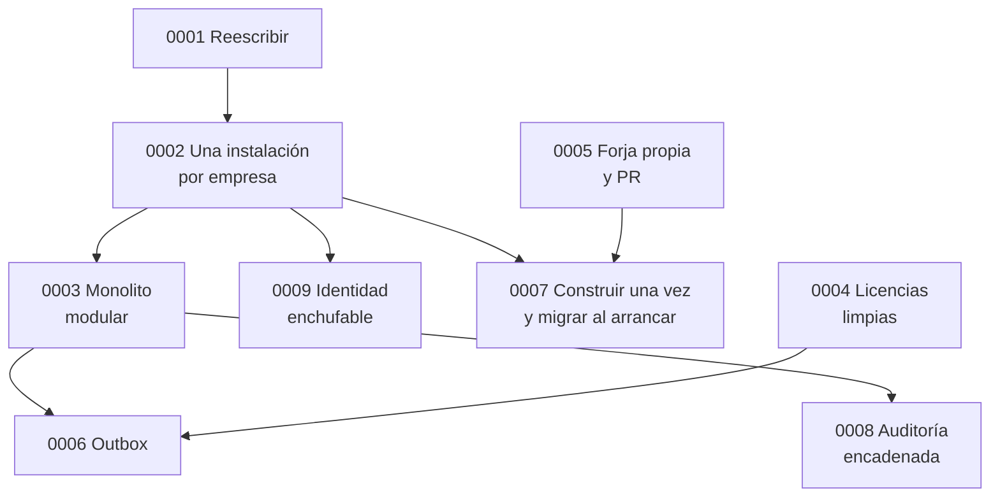

# Registro de decisiones

Cada fichero recoge una decisión importante con el formato de Michael Nygard: contexto, decisión y consecuencias (las buenas, las malas y las neutras, todas juntas para no esconder ningún coste). Añado las alternativas que se descartaron, porque en varias de ellas el "no" fue tan importante como el "sí".

Las decisiones aceptadas no se editan. Si cambian, se escribe una nueva que sustituye a la anterior y la vieja lo indica en su estado.

| # | Decisión | Estado |
|---|---|---|
| [0000](0000-registrar-decisiones.md) | Registrar las decisiones | Aceptada |
| [0001](0001-reescribir-en-vez-de-parchear.md) | Reescribir en vez de parchear | Aceptada |
| [0002](0002-una-instalacion-por-empresa.md) | Una instalación por empresa, nunca alojado por nosotros | Aceptada, sustituye a un diseño multiinquilino previo |
| [0003](0003-monolito-modular.md) | Monolito modular, no microservicios | Aceptada |
| [0004](0004-piezas-con-licencia-limpia.md) | PostgreSQL, Valkey y SeaweedFS | Aceptada |
| [0005](0005-forja-propia-y-pr-como-aprobacion.md) | Forja Git propia y el Pull Request como aprobación | Aceptada |
| [0006](0006-eventos-con-outbox.md) | Eventos internos con outbox | Aceptada, pospuesta y luego aplicada |
| [0007](0007-construir-una-vez.md) | Construir una vez, promover por etiqueta, migrar al arrancar | Aceptada |
| [0008](0008-auditoria-encadenada.md) | Auditoría append-only con hash encadenado | Aceptada |
| [0009](0009-identidad-enchufable.md) | Identidad enchufable desde el primer día | Aceptada |
| [0010](0010-limite-de-login.md) | Límite de login por cuenta, y por IP real después | Aceptada |

Cómo se apoyan unas en otras:

